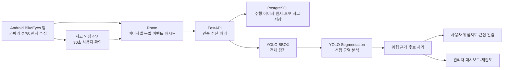

# BikeEyes

> 자전거 이용자 안전 향상을 위한 사고 감지 및 도로 상태 분석 시스템

BikeEyes는 스마트폰 카메라, GPS, 가속도·자이로·지자기 센서 데이터를 결합하여 자전거 주행 중 노면 위험요소와 사고 의심 상황을 분석하는 Android 기반 안전 지원 시스템입니다. 이미지 AI 분석 결과에 주행 맥락 데이터를 결합하고, 위험 근거를 누적·관리하여 이용자 알림과 관리자 검토에 활용합니다.

## 프로젝트 개요

### 1. 프로젝트 소개

- **프로젝트명**: BikeEyes
- **목적**: 스마트폰만으로 자전거도로의 노면 위험요소를 수집·분석하고, 사고 의심 상황의 확인 및 기록을 지원합니다.
- **분석 대상**: 포트홀, 맨홀, 볼라드, 침수구간, 거북등 균열, 선형 균열
- **구성**: Android 앱, FastAPI 서버, PostgreSQL DB, YOLO 기반 BBOX·Segmentation 모델, 관리자 기능

### 2. 개발 배경 및 필요성

자전거도로의 포트홀·균열·침수구간 등은 이용자의 안전을 위협하지만, 현장 점검만으로는 넓은 구간을 반복적으로 확인하기 어렵습니다. BikeEyes는 별도 전용 장비 없이 스마트폰의 카메라와 내장 센서를 활용해 주행 중 위험 근거를 수집하고, AI 분석과 주행 맥락을 결합해 관리 가능한 위험구간 정보로 전환하는 것을 목표로 합니다.

### 3. 프로젝트 특장점

- 단일 이미지 AI 결과만 사용하지 않고 GPS 정확도, 충격 변화량, 속도 등 주행 맥락을 함께 검토합니다.
- BBOX 객체 탐지와 Segmentation 영역 분석을 같은 원본 이미지에 순차 적용해 위험요소 유형별 분석 방식을 분리합니다.
- 서로 다른 주행의 근거를 공간적으로 누적한 뒤 자동 확정 조건을 적용하며, AI 미탐 항목은 관리자 재검토 흐름으로 별도 관리합니다.
- 사고 의심 감지는 서버 분석과 독립적으로 Android 단말에서 동작하며, 사고 전 이미지 기록을 블랙박스 근거로 보존합니다.

## 주요 기능

1. **주행 데이터 수집 및 동기화**
   - 주행 중 전방 이미지를 약 1초 간격으로 촬영하고 GPS·가속도·자이로·지자기 센서 데이터를 약 0.5초 간격으로 수집합니다.
   - 각 이미지 촬영 이후 1초 구간의 센서 샘플을 해당 이미지에만 배정하여 독립 이벤트로 저장하고, Room의 상태 기반 재시도 정책으로 서버에 순차 동기화합니다.

2. **노면 위험요소 AI 분석**
   - 동일 원본 이미지에 BBOX 탐지와 Segmentation 분석을 직렬 적용합니다.
   - BBOX는 포트홀·맨홀·볼라드·침수구간·거북등 균열을, Segmentation은 선형 균열을 분석합니다.
   - 클래스별 confidence와 동일 유형 IoU 중복 제거를 적용한 뒤 GPS·Peak 충격량·속도 조건을 결합해 위험 근거를 생성합니다.

3. **위험구간 후보 관리 및 사용자 알림**
   - 유효 AI 탐지와 GPS 정확도 조건을 충족하면 ROAD_ANOMALY 근거를 생성합니다.
   - 후보는 동일 주행 중복 제거와 공간 클러스터링을 거쳐 누적되며, 서로 다른 주행 3회 이상 및 평균 유효 AI confidence 0.60 이상일 때 자동 확정됩니다.
   - 사용자 공개 대상인 확정 위험구간은 지도에서 조회하고 근접 시 알림으로 안내합니다.

4. **AI 미탐 관리자 재검토**
   - 유효 AI 탐지가 없더라도 Peak impact_delta와 GPS 속도 조건을 모두 충족하면 관리자 전용 재검토 항목을 생성합니다.
   - 관리자는 위험요소를 복수 선택하여 후보로 등록하거나 ‘해당 사항 없음’으로 처리할 수 있습니다.

5. **사고 의심 감지 및 블랙박스 기록**
   - 가속도 충격, 자이로 회전, 자세 변화, 정지 유지, GPS 품질을 종합해 Android 단말에서 사고 의심 상황을 판단합니다.
   - 30초 사용자 확인 결과에 따라 ACCIDENT, NO_RESPONSE, SAFE를 저장하며, 사고 또는 무응답은 사고 시각 이전 최대 90초의 이미지를 사고 근거로 연결·보존합니다.

## 시스템 구성도

Android 단말의 H/W 센서·카메라 데이터가 Room 기반 동기화를 거쳐 서버·AI 분석·DB·사용자/관리자 기능으로 연결되는 전체 서비스 흐름입니다.



## 기술 스택

| 구분 | 사용 기술 |
| --- | --- |
| Android | Kotlin, Jetpack Compose, CameraX, Room, Retrofit, OkHttp, Kakao Map SDK |
| Server | Python 3.12, FastAPI, Uvicorn, PostgreSQL 16, Argon2, JWT, SMTP |
| AI | Ultralytics YOLOv8 BBOX, YOLOv8 Segmentation |
| Data | GPS, 가속도계, 자이로스코프, 지자기 센서, PostgreSQL |
| 협업·형상 관리 | Git, GitHub |

## 소스 구조

```text
BikeEyes/
├─ android/
│  └─ bikeeyes-app/              # Kotlin·Compose 기반 Android 앱
│     └─ app/src/main/           # 주행 수집, Room, UI, 지도, 사고 의심 감지
├─ server/
│  └─ bikeeyes-server/           # FastAPI·PostgreSQL·AI 분석 서버
│     ├─ app/                    # API, 인증, AI 파이프라인, 위험구간 정책
│     ├─ migrations/             # PostgreSQL 스키마 마이그레이션
│     └─ tests/                  # 서버 기능 검증 코드
└─ README.md
```

## 실행 방법

### 1. Android 앱

1. Android Studio에서 `android/bikeeyes-app` 폴더를 프로젝트로 엽니다.
2. `local.properties.example`을 참고하여 로컬 `local.properties`를 만들고 Android SDK 경로와 Kakao Native App Key를 설정합니다.
3. 연결된 Android 기기 또는 에뮬레이터에서 앱을 빌드·실행합니다.

### 2. FastAPI 서버

1. PostgreSQL 16 데이터베이스를 준비하고 `server/bikeeyes-server/migrations`의 SQL을 순서대로 적용합니다.
2. Python 3.12 환경에서 의존성을 설치합니다.

   ```bash
   cd server/bikeeyes-server
   pip install -r requirements.txt
   pip install -r requirements-ai.txt
   ```

3. 로컬 환경 변수에 DB 연결 정보, JWT Secret, Kakao REST API Key, SMTP 설정을 구성합니다. 실제 비밀값은 저장소에 포함하지 않습니다.
4. AI 모델 가중치 파일은 저장소에 포함하지 않으며, 아래 경로에 별도로 배치합니다.

   ```text
   models/bbox/best.pt
   models/segmentation/best.pt
   ```

5. 서버를 실행합니다.

   ```bash
   python -m uvicorn app.main:app --host 0.0.0.0 --port 8000
   ```

## 핵심 소스코드

| 기능 | 주요 코드 |
| --- | --- |
| 이미지별 센서 구간 구성·Peak Sample 선정 | [`SensorLoggingService.kt`](android/bikeeyes-app/app/src/main/java/com/bikeeyes/app/SensorLoggingService.kt) |
| Room 기반 업로드 재시도·서버 순차 동기화 | [`SensorUploadRepository.kt`](android/bikeeyes-app/app/src/main/java/com/bikeeyes/app/SensorUploadRepository.kt) |
| API·이미지 수신·사고·관리 기능 | [`main.py`](server/bikeeyes-server/app/main.py) |
| BBOX·Segmentation 직렬 AI 분석 | [`ai_pipeline.py`](server/bikeeyes-server/app/ai_pipeline.py) |
| 위험 근거·후보·자동 확정 정책 | [`hazard_rules.py`](server/bikeeyes-server/app/hazard_rules.py) |

### 이미지별 센서 구간과 Peak Sample 선정

아래 Android 코드는 이미지 촬영 시각 이후 1초 구간의 센서값만 해당 이미지 이벤트에 배정하고, 충격 변화량이 가장 큰 샘플을 Peak로 선정합니다.

```kotlin
val selected = sensorSampleBuffer
    .filter { it.sampled_at > frame.capturedAt && it.sampled_at <= windowEnd }
    .sortedBy { it.sampled_at }
sensorSampleBuffer.removeAll { it.sampled_at <= windowEnd }

private fun selectPeakSample(samples: List<SensorSample>): SensorSample? =
    samples.maxByOrNull { it.impactDelta() }
```

전체 구현은 [`SensorLoggingService.kt`](android/bikeeyes-app/app/src/main/java/com/bikeeyes/app/SensorLoggingService.kt)에서 확인할 수 있습니다.

## 팀원 소개

개인정보 보호를 위해 이름과 소속은 기재하지 않습니다.

| 역할 | 담당 영역 |
| --- | --- |
| 멘토 | 프로젝트 개발 방향 및 기술 구현 자문, 주요 산출물 검토 |
| 지도교수 | 프로젝트 연구 방향 지도, 기술·AI 결과 검토, 산출물 및 발표자료 자문 |
| 팀장 | 프로젝트 일정·산출물 총괄, Android 앱 구조 설계·구현, 회원·인증·주행·경로·위험지도·사고 기록 기능 개발, FastAPI API·PostgreSQL DB 연동·관리자 기능 개발, 통합 테스트 및 문서 작성 |
| AI 모델 개발 | 노면 위험요소 탐지 모델 학습·파인튜닝, BBOX·Segmentation 분석 구조 설계, AI 추론 결과·confidence 기준 검토, AI 분석 결과 서버 연동 지원 |
| AI 데이터·검증 | 학습·테스트 데이터 수집·정제·라벨링, 클래스 구성·데이터셋 관리, 모델 성능 평가·오탐·미탐 분석, 실제 주행 이미지 기반 AI 분석 결과 검증 |
| Android·통합 개발 | Android 앱 UI/UX 및 비AI 기능 공동 개발, 화면 설계, 주행·카메라·GPS·센서 수집·Room 동기화 기능 개발, 서버·DB 연동 및 관리자 화면 기능 지원, 실제 주행 테스트·결과 정리·문서 작성 |

## 작품 소개 영상

[](https://www.youtube.com/watch?v=fB_vjgZuWmY)

이미지를 클릭하면 YouTube 작품 소개 영상이 열립니다.

## 기대 효과 및 활용 분야

- **기대 효과**: 자전거 이용자가 주행 전후 위험구간 정보를 확인하고, 위험요소를 조기에 인지하도록 지원합니다. 관리자 관점에서는 수집 근거와 검토 흐름을 통해 현장 점검의 우선순위 설정에 활용할 수 있습니다.
- **활용 분야**: 자전거도로 안전 관리, 지자체 도로 유지관리 보조, 캠퍼스·공원 등 폐쇄형 이동 경로의 위험요소 모니터링, 이용자 참여형 안전지도 서비스에 적용할 수 있습니다.

## 보안 및 공개 범위

- `.env`, API Key, SMTP 계정·비밀번호, JWT Secret, 실제 DB 데이터, 주행 원본 이미지, ngrok 토큰은 공개 저장소에 포함하지 않습니다.
- AI 모델 가중치(`*.pt`)와 빌드 산출물(`*.apk`, `*.aab`)은 저장소에서 제외합니다.
- 본 저장소는 한이음 드림업 공모전 평가를 위한 현재 BikeEyes 구현 소스 기준으로 구성했습니다.
